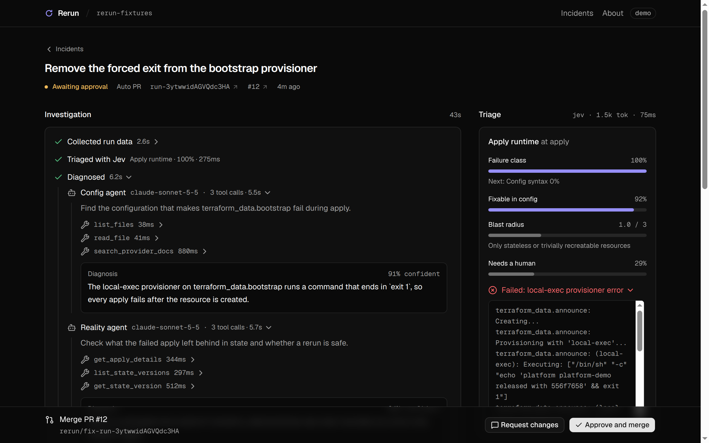
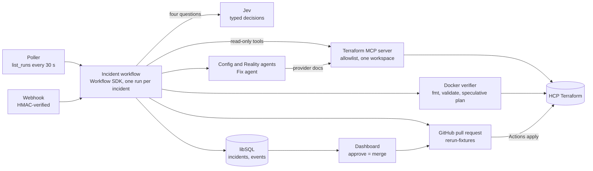
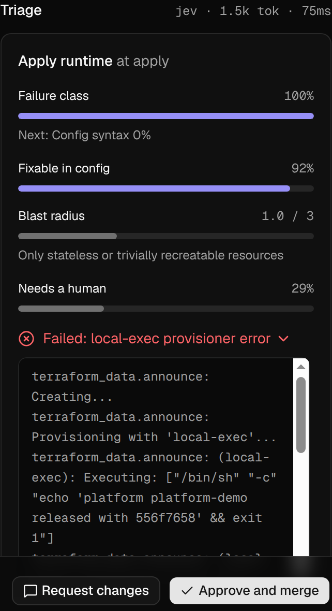
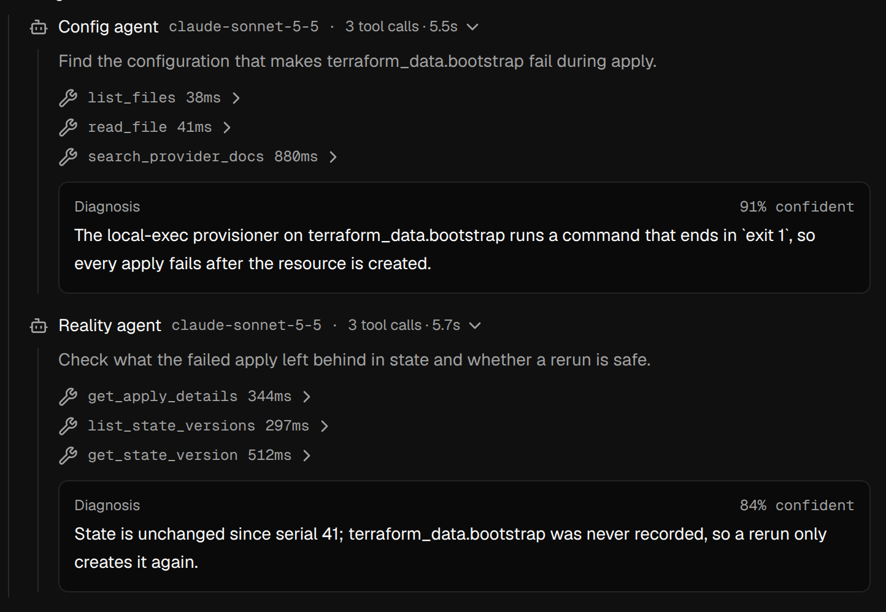
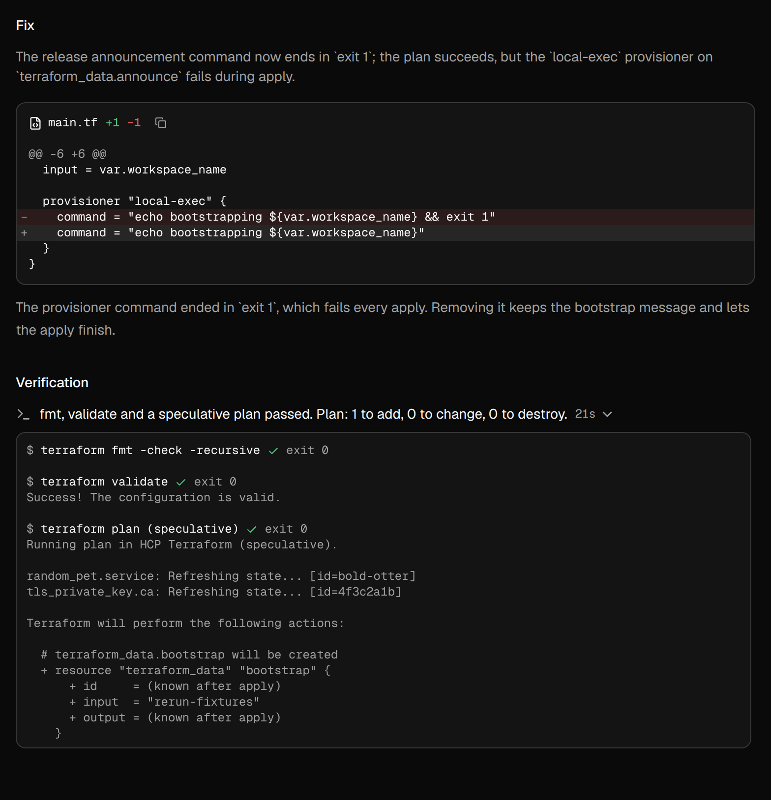

# Rerun

When an HCP Terraform run fails, Rerun reads the failure through the Terraform MCP server, classifies it with a typed decision model, writes the smallest fix, proves it with a speculative plan and opens a pull request that a human approves from a dashboard.

[](https://github.com/tayden-b/rerun/actions/workflows/ci.yml)
[](#evals)
[](#why-the-terraform-mcp-server)



## Why the Terraform MCP server

Every piece of Terraform data Rerun uses comes from the [Terraform MCP server](https://github.com/hashicorp/terraform-mcp-server), the same server a platform team already runs for its engineers' coding agents. Rerun adds no HCP Terraform API client of its own. That makes the integration a configuration decision rather than code:

- **Read-only by construction.** The server is started with `--tools=<allowlist>`, so only the tools below are registered. `ENABLE_TF_OPERATIONS` is never set; Rerun cannot queue, apply or discard a run.
- **One workspace.** The client in `src/mcp/terraform.ts` refuses any call that names a workspace, run, plan or state version outside `RERUN_WORKSPACE` (`WorkspaceScopeError`).
- **One token holder.** `TFE_TOKEN` is read by the MCP sidecar and by the Docker verifier for the speculative plan, nowhere else.
- **Human merge.** Rerun opens pull requests. Approving in the dashboard merges one; the repository's own pipeline applies it.



Every Terraform MCP tool on the allowlist, generated from `src/mcp/allowlist.ts` by `npm run eval:readme`:

<!-- mcp-tools:start -->

| Tool                          | Toolset   | What Rerun uses it for                                                                           | Called from           |
| ----------------------------- | --------- | ------------------------------------------------------------------------------------------------ | --------------------- |
| `list_workspaces`             | terraform | Not called; the scope guard only allows a filter on the watched workspace.                       | —                     |
| `get_workspace_details`       | terraform | Resolves the workspace id that state reads need; part of every incident context.                 | `collectRunArtifacts` |
| `list_runs`                   | terraform | Polls for newly errored runs and for the run after a merge.                                      | `src/watch/runs.ts`   |
| `get_run_details`             | terraform | Run status, message and the plan and apply ids; proves the run belongs to the watched workspace. | `collectRunArtifacts` |
| `get_plan_details`            | terraform | Plan status: did the run fail in init/plan or get past it.                                       | `collectRunArtifacts` |
| `get_plan_logs`               | terraform | The failing log, from which the 120-line error excerpt is cut.                                   | `collectRunArtifacts` |
| `get_plan_json_output`        | terraform | Planned resource changes for the blast-radius question. Scrubbed of private keys first.          | `collectRunArtifacts` |
| `get_apply_details`           | terraform | Apply status, when the plan succeeded.                                                           | `collectRunArtifacts` |
| `get_apply_logs`              | terraform | The apply-time error (provisioners, API calls during apply).                                     | `collectRunArtifacts` |
| `list_state_versions`         | terraform | Not called by the incident flow; the scope guard uses it to check an explicit state version id.  | —                     |
| `get_state_version`           | terraform | Current state outputs and resources, for the Reality agent.                                      | `collectRunArtifacts` |
| `get_run_comments`            | terraform | Not called yet; exposed for a comment-back surface.                                              | —                     |
| `whoami`                      | terraform | Identity check when recording fixtures.                                                          | `scripts/record.ts`   |
| `search_provider_docs`        | registry  | Finds the provider doc for an argument or attribute named in the error.                          | Config and Fix agents |
| `get_provider_details`        | registry  | Reads that doc page, e.g. which tls v4 attributes are read-only.                                 | Config and Fix agents |
| `get_latest_provider_version` | registry  | Not called yet; exposed for version-conflict fixes.                                              | —                     |
| `get_provider_capabilities`   | registry  | Not called yet; exposed for version-conflict fixes.                                              | —                     |

<!-- mcp-tools:end -->

## How a failed run becomes a merged fix

One workflow run per incident (`workflows/`); every step writes events that the dashboard renders as a live trace.

1. **Collect.** The poller (or webhook) sees an `errored` run. Rerun pulls the run, plan, logs, plan JSON, apply and current state through MCP, and cuts a 120-line error excerpt with secrets redacted.
2. **Triage.** One Jev request answers four questions: failure class (12 closed classes), whether a configuration change alone can fix it, blast radius, and whether a human must decide. The answers are probabilities, not prose.

   

3. **Diagnose.** The Config agent reads the repository and the log; the Reality agent also reads state and apply output when the failure happened at apply time or outside the configuration. Both cite evidence (file and line, log line, provider doc).

   

4. **Fix.** The Fix agent edits a working copy of the configuration and gives a rationale per file.
5. **Verify.** `terraform fmt -check`, `terraform validate` and a speculative remote plan run in `hashicorp/terraform:1.14`. On failure the fix is retried once with the verifier output; then the incident goes to a human.

   

6. **Propose.** Rerun opens the pull request with the evidence in its body. The router (`autoPr` iff `config_fixable` ≥ 0.70, `blast_radius` ≤ 1.0 and `needs_human` ≤ 0.40) decides between a ready-for-review PR and a draft flagged for a human.
7. **Approve.** A human reads the war room and presses Approve, which merges the PR, or Request changes, which posts a PR comment.

   

8. **Confirm.** The fixtures repository's GitHub Actions applies the merge. Rerun watches the next run: `applied` resolves the incident, `errored` opens a new incident linked to this one.

## Evals

`npm run eval` scores triage on the eleven recorded scenarios of [rerun-fixtures](https://github.com/tayden-b/rerun-fixtures) (real MCP outputs and real Jev answers, replayed offline). `npm run eval -- --live` breaks each scenario on the real workspace and runs the whole flow. `npm run eval:readme` renders `evals/results.json` below; nothing between the markers is edited by hand.

Accuracy is against `expected.json` in each scenario. Calibration compares stated probabilities with outcomes in 0.1 bins. The flip rate counts verdicts that change when the input is perturbed without changing its meaning (renamed resources, an extra UUID line, reordered plan entries). Cost covers the triage call only; agent and verifier costs are in the live table and on each incident.

<!-- evals:start -->

Generated 2026-11-21 from `evals/results.json`: 11 scenario(s), 5 perturbation(s) per scenario, prices as of 2026-11-20.

### Triage accuracy

| Provider | Scenarios | Errors | Class accuracy | Route accuracy | Mean latency | Mean input tokens | Triage cost / incident |
| -------- | --------- | ------ | -------------- | -------------- | ------------ | ----------------- | ---------------------- |
| recorded | 11        | 0      | 100%           | 100%           | 57 ms        | 1410              | $0.000059              |

### Accuracy per failure class

Correct `failure_class` answers out of the scenarios of that class. Each cell is one provider on the same recorded MCP data.

| Class                 | Scenarios | recorded |
| --------------------- | --------- | -------- |
| `apply_runtime`       | 1         | 1/1      |
| `provider_api_error`  | 1         | 1/1      |
| `precondition_failed` | 2         | 2/2      |
| `dependency_cycle`    | 1         | 1/1      |
| `config_syntax`       | 2         | 2/2      |
| `module_source`       | 1         | 1/1      |
| `provider_version`    | 1         | 1/1      |
| `config_reference`    | 1         | 1/1      |
| `missing_input`       | 1         | 1/1      |

### Question rewording: before and after

Same scenarios and SPEC §4 thresholds (`autoPr` iff `config_fixable` ≥ 0.70, `blast_radius` ≤ 1.0, `needs_human` ≤ 0.40); only the question wording changed. Before: recorded Jev answers of 2026-11-21. After: recorded Jev answers of 2026-11-21.

| Scenario                    | Expected  | `config_fixable` before | after | `needs_human` before | after | Route before | after     |
| --------------------------- | --------- | ----------------------- | ----- | -------------------- | ----- | ------------ | --------- |
| `apply-time-exit-1`         | `autoPr`  | 0.88                    | 0.92  | 0.69                 | 0.29  | `draftPr`    | `autoPr`  |
| `bad-http-url`              | `autoPr`  | 0.77                    | 0.90  | 0.56                 | 0.31  | `draftPr`    | `autoPr`  |
| `check-block-failure`       | `autoPr`  | 0.83                    | 0.95  | 0.77                 | 0.29  | `draftPr`    | `autoPr`  |
| `dependency-cycle`          | `autoPr`  | 0.88                    | 0.92  | 0.69                 | 0.16  | `draftPr`    | `autoPr`  |
| `http-404-postcondition`    | `autoPr`  | 0.73                    | 0.92  | 0.69                 | 0.26  | `draftPr`    | `autoPr`  |
| `missing-required-arg`      | `autoPr`  | 0.97                    | 0.98  | 0.49                 | 0.19  | `draftPr`    | `autoPr`  |
| `module-source-typo`        | `draftPr` | 0.78                    | 0.79  | 0.55                 | 0.52  | `draftPr`    | `draftPr` |
| `provider-version-conflict` | `draftPr` | 0.68                    | 0.85  | 0.63                 | 0.79  | `draftPr`    | `draftPr` |
| `removed-argument`          | `autoPr`  | 0.94                    | 0.96  | 0.25                 | 0.12  | `autoPr`     | `autoPr`  |
| `undeclared-reference`      | `autoPr`  | 0.96                    | 0.97  | 0.43                 | 0.18  | `draftPr`    | `autoPr`  |
| `unset-variable`            | `autoPr`  | 0.59                    | 0.95  | 0.56                 | 0.30  | `draftPr`    | `autoPr`  |
| Route matches expected      |           |                         |       |                      |       | 3/11         | 11/11     |

### Calibration

Outcome: `autoPr` in `expected.json` means config-fixable = 1 and needs-human = 0. ECE = expected calibration error over 0.1-wide bins (lower is better).

| Provider | Signal           | n   | ECE  |
| -------- | ---------------- | --- | ---- |
| recorded | `config_fixable` | 11  | 0.20 |
| recorded | `needs_human`    | 11  | 0.25 |

| Provider | Signal           | Bin     | n   | Mean predicted | Observed |
| -------- | ---------------- | ------- | --- | -------------- | -------- |
| recorded | `config_fixable` | 0.7–0.8 | 1   | 0.79           | 0.00     |
| recorded | `config_fixable` | 0.8–0.9 | 1   | 0.85           | 0.00     |
| recorded | `config_fixable` | 0.9–1.0 | 9   | 0.94           | 1.00     |
| recorded | `needs_human`    | 0.1–0.2 | 4   | 0.16           | 0.00     |
| recorded | `needs_human`    | 0.2–0.3 | 3   | 0.28           | 0.00     |
| recorded | `needs_human`    | 0.3–0.4 | 2   | 0.30           | 0.00     |
| recorded | `needs_human`    | 0.5–0.6 | 1   | 0.52           | 1.00     |
| recorded | `needs_human`    | 0.7–0.8 | 1   | 0.79           | 1.00     |

### Robustness

Each scenario state is perturbed without changing its meaning (consistent resource renames, an extra UUID line, reordered plan entries, whitespace). A flip is a run whose class or route differs from the unperturbed run.

| Provider | Perturbed runs | Flips | Flip rate |
| -------- | -------------- | ----- | --------- |
| recorded | 55             | 0     | 0%        |

### End-to-end (live)

| Scenario | Reached status | Verifier passed | PR  | fixTouches respected | Duration |
| -------- | -------------- | --------------- | --- | -------------------- | -------- |
| not run  | —              | —               | —   | —                    | —        |

- The recorded provider replays a fixed answer, so its flip rate is 0 by construction.

<!-- evals:end -->

### What the question rewording changed

The first live recording got the class and stage right in all 11 scenarios but put `needs_human` above 0.40 in 10 of them. The old question asked whether a fix needed "a human decision (ambiguous intent, security-sensitive change, or more than one reasonable fix)". Almost every Terraform change has more than one reasonable fix, so the model answered yes for a missing argument and a misspelled reference alike.

The rewrite in `src/decisions/questions.ts` leaves the class question alone. Most of it is general: each routing question now says what Rerun can change (any `.tf` or `.tfvars` file, through a pull request a human approves) and what it cannot (credentials, quota, systems outside Terraform), and `needs_human` says that review always happens, so several equivalent ways to write a fix no longer counts as needing a human. The blast-radius question gained one clarification: replacing a resource that holds no data is the second level, not higher.

One sentence is domain policy chosen with the fixtures in view: a fix that edits a module source or version, or a `required_providers` or `required_version` constraint, counts as an owner decision because it changes which dependency code gets installed. We think that is the right default for a platform team, but it is also what keeps the two init-stage scenarios on `draftPr`, so part of the 11/11 is that policy rather than better judgment. `apply-time-exit-1` has no margin: its `blast_radius` sits at the 1.0 limit (Jev 1.00, LLM 1.02). Eleven scenarios is a small set; the wording needs its own scenarios on any real estate before `autoPr` is trusted.

## Things we learned

Dated 2026-11-21; versions as pinned in this repository.

- **`TRANSPORT_MODE` disables the tool allowlist.** In `hashicorp/terraform-mcp-server:1.4`, setting `TRANSPORT_MODE` makes the server ignore `--tools` and register every toolset. Rerun starts it with the `streamable-http` subcommand and `--transport-host=0.0.0.0 --transport-port=8080 --tools=<allowlist>` instead (`docker-compose.yml`). Check `tools/list` after any change to how the server is started.
- **Init failures never reach HCP Terraform from a CLI-driven workflow.** When `terraform init` fails on the CI runner, no remote run is queued, so there is nothing for Rerun to see. The fixtures repository's Actions workflow uploads the configuration through the HCP Terraform API in that case, which produces a remote run that fails at init. HCP Terraform reports it inside the plan phase: `Operation failed: failed running terraform init`.
- **`check` blocks only warn.** A failing `check` assertion does not fail a run. The `check-block-failure` scenario enforces the same guardrail as a resource `precondition`, so its class is `precondition_failed`.
- **Plan JSON carries private keys in clear text.** The baseline's `tls_private_key.platform` writes its PEM private key into the raw plan JSON returned by `get_plan_json_output`. Unfiltered, that key would have gone to both models and into the recorded fixtures; a code review of the recording PR caught it. `src/mcp/scrub.ts` now replaces any `-----BEGIN … PRIVATE KEY-----` block with `[REDACTED:private_key]` before trace emission, recording or model input, and `test/fixtures/redaction.test.ts` fails on any PEM key under `fixtures/`. The key had been readable in one unmerged commit, so it was rotated with an HCP Terraform replace run of `tls_private_key.platform` and `tls_self_signed_cert.platform`. Plan JSON and state are secret-bearing: scrub them before any model sees them, whatever the provider marks as sensitive.
- **Two log formats.** CLI-driven runs log JSON lines (`{"@level":"error","@message":"Error: …"}`); API-queued runs log plain text with `│ Error:` blocks. The excerpt builder normalises both.

## Quickstart

Demo mode needs no credentials: a mock MCP server serves the recorded fixtures, and the decision provider, GitHub client and verifier are replaced with recorded or fake ones.

```bash
git clone https://github.com/tayden-b/rerun && cd rerun
npm ci
npm run demo   # app on http://localhost:3000, mock Terraform MCP server on :8080
```

Live mode needs an HCP Terraform workspace that applies from a GitHub repository (fork [rerun-fixtures](https://github.com/tayden-b/rerun-fixtures)), Docker, and the keys listed in `.env.example`.

```bash
cp .env.example .env.local          # TFE_TOKEN, TFE_ORG, GITHUB_TOKEN, JEV_API_KEY, ANTHROPIC_API_KEY
docker compose up -d terraform-mcp  # Terraform MCP server on 127.0.0.1:8080 with the allowlist
npm run db:migrate
npm run dev                         # polls the workspace every 30 s
# in the fixtures repository: scripts/break.sh http-404-postcondition
```

## What a customer would extend

- **Drift with Search & Import.** `drift` is already a class and always routes to a draft PR. HCP Terraform Search & Import (Terraform 1.14 `list` blocks and `terraform query`) can generate the `import` blocks that adopt a drifted resource, so the Fix agent proposes an import instead of a rewrite.
- **Sentinel and OPA policy failures.** A policy check failure is a new class. HCP Terraform exports Sentinel mock data for each plan; the verifier can run `sentinel test` against the mocks before the PR is opened.
- **Vercel Sandbox verifier.** `src/verify/vercel-sandbox.ts` implements the `Verifier` interface as a stub. A sandbox removes the local Docker dependency and isolates each plan.
- **Slack or MCP Apps surface.** The war room's Approve and Request changes map onto an interactive Slack message or an MCP App, so the approval happens where the platform team already works.
- **More workspaces.** The scope guard takes one workspace name; a list and a per-workspace repository map make it an organization-wide watcher.

## Limitations

- One workspace and one repository per deployment.
- The dashboard has no authentication; anyone who can reach it can approve a merge.
- A speculative plan cannot prove an apply-time fix: for `apply_runtime` failures the verifier shows the plan succeeds, and only the post-merge apply confirms the fix.
- The routing thresholds and question wording were calibrated on eleven scenarios built on no-cloud providers. Real estates need their own scenarios before `autoPr` is trusted.
- The live eval is run by hand against a real workspace; CI runs demo mode only.
- Polling adds up to 30 s of latency; the webhook route removes it.

## Repository

| Path                                       | Contents                                                       |
| ------------------------------------------ | -------------------------------------------------------------- |
| `src/mcp/`                                 | Scoped Terraform MCP client, allowlist, scrubbing, mock server |
| `src/decisions/`                           | Jev and LLM decision providers, triage questions, router       |
| `src/agents/`                              | Config, Reality and Fix agents                                 |
| `src/verify/`, `src/github/`, `src/watch/` | Docker verifier, GitHub client, run watcher                    |
| `workflows/`                               | The incident workflow                                          |
| `app/`, `components/`                      | Dashboard                                                      |
| `evals/`                                   | Eval harness and the README renderer                           |
| `fixtures/scenarios/`                      | Recorded MCP outputs and Jev answers per scenario              |

The specification is [`handoff/SPEC.md`](handoff/SPEC.md); contributor rules and commands are in [`AGENTS.md`](AGENTS.md).

## License

[MIT](LICENSE)
